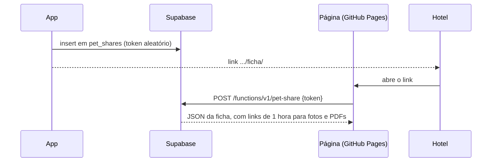

# Ficha compartilhada

A regra de produto está em [`docs/produto/ficha-compartilhada.md`](../produto/ficha-compartilhada.md). Três partes: a tabela `pet_shares` no Supabase, a Edge Function pública `pet-share` e a página estática em `web-share/`, publicada no GitHub Pages.

## No app

- `lib/features/share/domain/pet_share.dart`: `PetShare`, `SharePreset` (`care`, hotel ou creche; `vet`, veterinário), `newShareToken` (32 bytes aleatórios de `Random.secure`, em base64url: 43 caracteres) e `shareBaseUrl` (padrão `https://ficha.bowieapp.pet/`, trocável com `--dart-define=SHARE_BASE_URL=...`; a página da raiz encaminha um link com código para `ficha/`, o que deixa o link e o QR code mais curtos).
- `lib/features/share/data/pet_share_repository.dart`: os links só existem no servidor (a página lê de lá), então não passam pela outbox e precisam de internet. `activeShares` lista os que não foram cancelados nem venceram; `create` confere que a pessoa é tutora do pet e limpa o nome do lugar (até 60 caracteres); `revoke` grava `revoked_at`. Erros viram mensagens em português.
- `/pets/:id/compartilhar` (`PetSharePage`): escolha entre "Hotel ou creche" e "Veterinário", nome do lugar opcional, "Criar link" e "Links ativos". Antes de criar, o app sincroniza, porque a ficha mostra o que está no servidor (e um pet recém-cadastrado ainda não estaria lá). Criado o link, um bottom sheet mostra o QR code (`qr_flutter`, em Azul Noite sobre branco nos dois temas), "Enviar o link" (`share_plus`) e "Copiar o link". Se a conta não tem nome e celular, a tela sugere completar o cadastro.
- Na página do pet, "Compartilhar ficha do Bowie" fica depois dos tutores e antes de "Excluir este pet", para qualquer tutor.

## No Supabase

**`public.pet_shares`** (migração `20261014120000_notes_proofs_files_shares.sql`): `token` único (32 a 64 caracteres base64url), `preset`, `label`, `created_by`, `created_at`, `expires_at` (padrão `now() + 60 dias`, posto pelo servidor; uma checagem impede mais de 61 dias), `revoked_at`, `last_viewed_at`.

- RLS: tutores `accepted` do pet veem, criam (com `created_by` próprio) e cancelam. Sem acesso para `anon`.
- O gatilho `pet_shares_protect` só deixa mudar `revoked_at` (uma vez) e `last_viewed_at`.

**Edge Function `pet-share`** (`supabase/functions/pet-share/index.ts`), pública ("Verify JWT" desligado):

- Recebe `POST {token}`. Com token inválido, vencido, cancelado ou de pet excluído, responde 404 com a mesma mensagem, para não revelar se o token existe.
- Lê com a chave de serviço (`SUPABASE_SERVICE_ROLE_KEY`, que o Supabase já dá à função): pet, vacinas (agrupadas por nome, com status pelos mesmos 30 dias do app e comprovantes), cuidados, remédios em uso (sem fim ou com fim a partir de hoje, no fuso de São Paulo), e o tutor principal: nome e celular do `user_metadata` da conta, ou o email quando não há celular. Na ficha `vet`, também o diário (até 200 registros, com contato, fotos e PDFs).
- Fotos e PDFs vão como links assinados do Storage, de 1 hora.
- Grava `last_viewed_at`. O log tem só o id do link e o tipo de ficha.
- Responde com `Cache-Control: no-store` e CORS aberto (a página está em outro domínio).

## A página

`web-share/ficha/` (`index.html`, `ficha.css`, `ficha.js`), sem bibliotecas:

- O token vem depois do `#` no endereço, então não chega ao servidor do GitHub Pages; ele só vai no corpo do POST para a função.
- Monta a página com `textContent` (nada vindo do servidor vira HTML). Ícones Lucide embutidos.
- Usa os tokens de `design/tokens/tokens.css`, Figtree servida junto (sem Google Fonts) e o tema claro ou escuro do sistema. Tem botão "Imprimir" e estilo de impressão.
- `noindex` e `no-referrer`.

`scripts/build-web-share.sh` monta o site em `_site/` (página, tokens, fontes, logos e `config.js` com `SUPABASE_URL`). O workflow `.github/workflows/ficha-pages.yml` roda o script e publica no GitHub Pages a cada mudança em `web-share/` na `main`, ou pelo botão "Run workflow". Configuração em [publicar a ficha](../guias/ficha-compartilhada.md).
